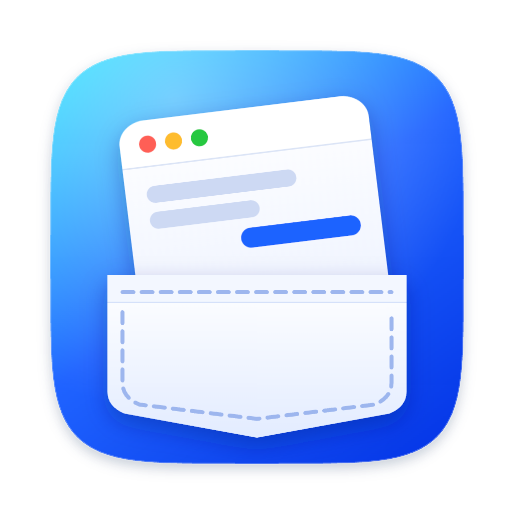

<div align="center">



# PocketDesk

**Make CrossDesk Native on iPhone**

装在 Mac 上，用开源免费的远控 CrossDesk 从 iPhone 连回来时，像在用原生 App<br>iPhone 专属竖屏 · 原生手势 · 打字不被键盘挡住 · 小横条左右滑切窗口

  [](LICENSE)

</div>

PocketDesk 是一个 Mac 应用，主要为了在手机上用 Mac 里的 Claude、ChatGPT 这类 App。它基于开源项目 [Snug](https://github.com/zephyr4123/snug) 开发，加上了对开源远控 [CrossDesk](https://github.com/kunkundi/crossdesk) 的适配：Mac 装 PocketDesk 和 CrossDesk，iPhone 只装 CrossDesk。

> [!NOTE]
> 从 Snug 换过来：PocketDesk 第一次启动时会拷来 Snug 的设置，屏名开头的「Snug 」换成「PocketDesk 」，Snug 自己的设置原样留着。
> bundle id 换了，辅助功能、录屏权限要重新给一次；两个别同时开。

## 能做什么

- **iPhone 专属竖屏**：在 Mac 上多建一块和 iPhone 比例一致的屏，窗口铺满手机，首页是 App 资源库
- **原生手势**：单指滑动是滚动（带惯性），长按后拖动是选字，长按松开是右键菜单
- **打字不被键盘挡住**：点进输入框，窗口自动让到键盘上方；让出来的那块铺一层托盘，写着怎么从 CrossDesk 的悬浮球打开键盘，收起键盘后点托盘铺回整屏
- **小横条左右滑切窗口**：画面底部的小横条点一下回 App 资源库，左右一滑切回这块屏上一个放过的窗口，比如去微信拷一段话再回 Claude 粘贴
- **都开源、都免费**：PocketDesk 是 MIT；CrossDesk 是 GPL-3.0，P2P 直连、打不通自动走中继，两端默认连它的公共服务器，不用配置

## 安装

从 [Releases](https://github.com/cccignore/pocketdesk/releases/latest) 下载 `PocketDesk-<版本>.dmg`，打开后把 PocketDesk 拖进「应用程序」。需要 macOS 14 以上，Apple 芯片和 Intel 通用。

安装包没有经过 Apple 公证（ad-hoc 签名）：第一次打开会被系统拦下，到「系统设置 → 隐私与安全性」最下面点「仍要打开」。应用内检查更新只提示有新版本、打开下载页，不会自动替换。

从源码装（需要 Xcode）：

```bash
git clone https://github.com/cccignore/pocketdesk.git
cd pocketdesk
scripts/snug install
```

## 怎么用

1. **Mac**：装 CrossDesk（[Releases](https://github.com/kunkundi/crossdesk/releases) 里的 `.pkg`），按提示给屏幕录制和辅助功能权限
2. **iPhone**：从 App Store 装 CrossDesk。中国大陆区商店没有上架，香港、台湾、日本、新加坡、美国区有；没有外区账号的，可以按 CrossDesk 仓库里 `apps/ios/README.md` 用 Xcode 自己签名装。设置里「鼠标控制」的控制模式选「绝对位置」
3. PocketDesk 和 CrossDesk 先开哪个都行：CrossDesk 看不到手机屏时（比它先启动、PocketDesk 重启过），没人远程、也确认了没人正在连的话 PocketDesk 会自动重启它，远程中不重启（这时退出 CrossDesk 会断掉远程、锁屏）。自动重启没成时菜单栏留着「重启 CrossDesk」，点一下
4. iPhone 连上后，在 CrossDesk 悬浮球的「显示器」里选 PocketDesk 的屏（CrossDesk 每次连上都从第一块屏开始）
5. 要打字时从悬浮球的「键盘」打开键盘

细节和已知限制见 [CrossDesk 适配](docs/remotes/crossdesk.md)，原理见 [工作原理](docs/how-it-works.md)。Snug 原有的 UU远程 适配也还在，说明见 [Snug 原版 README](README.snug.md)。

## 致谢与许可

- 基于 [zephyr4123/snug](https://github.com/zephyr4123/snug)（MIT）开发，Snug 又承接自 [aoyamashou/UUyc-companion](https://github.com/aoyamashou/UUyc-companion)（MIT），完整保留了两位原作者的版权声明和提交历史
- 适配 [kunkundi/crossdesk](https://github.com/kunkundi/crossdesk)（GPL-3.0）：CrossDesk 是单独安装的 App，本仓库不含它的代码
- 本仓库以 [MIT](LICENSE) 许可发布
